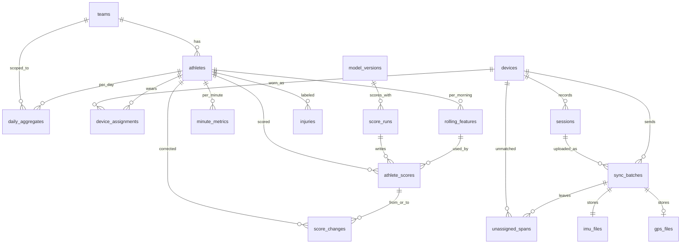

# Data model

Injury risk is scored from daily workload, not from the 100 Hz samples. Raw inertial and GPS files live in S3. Everything the morning score reads or the coach looks up lives in Postgres.

Business timestamps are `timestamp` without a time zone, plus a `tz` column holding an IANA name such as `America/New_York`. The date of a sample, session, assignment, or minute is the date part of that wall-clock value. An evening session that crosses UTC midnight stays on one local date. Raw sample times are the exception: the file stores them as UTC instants, and the worker converts them to that wall time once.

`received_at`, `created_at`, `recorded_at`, `updated_at`, `approved_at`, `started_at`, `finished_at`, and `scored_at` are UTC instants. They record when the server did something. They do not decide which day a session belongs to.

## Entity diagram



`imu_files` and `gps_files` are S3 objects, not Postgres tables. A batch points at them with `s3_uri`. An `athlete_scores` row points at the `rolling_features` revision it used by `athlete_id`, `as_of_date`, and `feature_revision`. `feature_set_version` comes from the `model_versions` row of that score run, and `feature_hash` confirms the vector.

## teams

One organization timezone. 06:00 and every local date use `tz`.

| Column | Type | Key |
| --- | --- | --- |
| team_id | uuid | PK |
| name | text | |
| tz | text | IANA name |

## athletes

| Column | Type | Key |
| --- | --- | --- |
| athlete_id | uuid | PK |
| team_id | uuid | FK to teams |
| display_name | text | |
| position | text | Copied onto `rolling_features` at score time |
| active | boolean | Inactive athletes are left out of the 06:00 run |

## devices

A device is identified by serial. It is not tied to one athlete.

| Column | Type | Key |
| --- | --- | --- |
| device_id | uuid | PK |
| serial | text | Unique |
| firmware | text | |

## device_assignments

Who wore the device. Samples are attributed with the assignment that covers the sample's local time.

| Column | Type | Key |
| --- | --- | --- |
| assignment_id | uuid | PK |
| device_id | uuid | FK to devices |
| athlete_id | uuid | FK to athletes |
| valid_from | timestamp | Local wall time. Start of the half-open range |
| valid_to | timestamp | Local wall time. Null while the assignment is open |
| tz | text | IANA name |
| reason | text | `pre_session`, `mid_session_swap`, or `correction` |
| created_at | timestamptz | UTC. When the row was written |

The range is half-open: `[valid_from, valid_to)`. Ranges for one `device_id` in one `tz` cannot overlap.

## sessions

One continuous recording on a device. The device supplies `session_id`. Chunks of the same session share it.

| Column | Type | Key |
| --- | --- | --- |
| session_id | uuid | PK. Supplied by the device |
| device_id | uuid | FK to devices |
| started_at | timestamp | Local wall time |
| ended_at | timestamp | Local wall time |
| tz | text | IANA name |
| expected_imu_rows | bigint | Samples the device recorded for the whole session, known before every chunk has uploaded |
| metric_date | date | Date part of `started_at`. No timezone conversion |

Minutes after local midnight stay on this `metric_date`. A session from 23:10 to 00:40 counts on the day it started.

## sync_batches

One uploaded chunk of a session. `batch_id` is the gateway's idempotency key. A repeated `batch_id` returns the original row.

| Column | Type | Key |
| --- | --- | --- |
| batch_id | uuid | PK. Supplied by the gateway |
| session_id | uuid | FK to sessions |
| device_id | uuid | FK to devices |
| received_at | timestamptz | UTC. When the server accepted the batch |
| local_ts_start | timestamp | Local wall time of the first sample in the chunk |
| local_ts_end | timestamp | Local wall time of the last sample in the chunk |
| tz | text | IANA name |
| utc_offset_minutes | integer | Offset applied when `utc_ts` was converted to team local time. `-240` for `America/New_York` in March |
| s3_uri | text | Object written by the dock |
| content_sha256 | text | Hash sent when the upload completes |
| imu_rows | bigint | Inertial rows in this chunk |
| gps_rows | bigint | GPS rows in this chunk |
| status | text | `pending`, `landed`, `aggregated`, or `failed` |

`pending` means the presigned URL was issued and the file is not confirmed yet. `landed` means the object is in S3 and one queue message was published.

## minute_metrics

Rebuilt for the athletes in a session. Used to drill into a day. Replaced when that session is rebuilt.

| Column | Type | Key |
| --- | --- | --- |
| athlete_id | uuid | PK, FK to athletes |
| minute_ts | timestamp | PK. The local minute |
| tz | text | IANA name |
| session_date | date | Date part of `minute_ts` |
| distance_m | numeric | Metres |
| high_speed_distance_m | numeric | Metres above the high-speed threshold |
| sprint_count | integer | |
| accel_load | numeric | Sum of the Euclidean norm of successive accelerometer deltas |
| impact_count | integer | |
| max_speed_mps | numeric | Metres per second |
| duration_s | numeric | Seconds of usable samples in the minute |
| coverage | numeric | Usable samples in the minute divided by the samples expected for that minute. From 0 to 1 |
| metric_version | integer | Version of the `accel_load` formula |

## daily_aggregates

The facts the morning features are built from. One row per athlete per session-start date. A rest day has no row.

| Column | Type | Key |
| --- | --- | --- |
| athlete_id | uuid | PK, FK to athletes |
| metric_date | date | PK. Session start date. A session that crosses local midnight counts entirely on the day it started |
| team_id | uuid | FK to teams |
| distance_m | numeric | Metres |
| high_speed_distance_m | numeric | Metres |
| sprint_count | integer | |
| accel_load | numeric | Same formula as `minute_metrics.accel_load` |
| impact_count | integer | |
| max_speed_mps | numeric | Metres per second |
| duration_s | numeric | Seconds of usable samples |
| session_count | integer | Sessions whose `metric_date` is this date |
| coverage | numeric | Valid attributed inertial samples divided by `expected_imu_rows` for this athlete's sessions on this date. From 0 to 1 |
| metric_version | integer | Version of the `accel_load` formula |
| updated_at | timestamptz | UTC. When this row was last rebuilt |

Coverage is the share of the session that has arrived. A 90-minute recording with only the first 36 minutes uploaded has coverage 0.4. Observed load is not scaled up to fill the gap.

`coverage_7d` on `rolling_features` is the average of this value over the session days in the 7 days before `as_of_date`. Rest days are skipped. Below 0.7 the morning score is `insufficient_data`.

## rolling_features

One revision per compute, every morning, for every active athlete. `as_of_date` is the day being predicted.

| Column | Type | Key |
| --- | --- | --- |
| athlete_id | uuid | PK, FK to athletes |
| as_of_date | date | PK. The morning being predicted |
| feature_set_version | integer | PK. Must match the model that scores the row |
| revision | integer | PK. 1 is the 06:00 vector. Later revisions correct that same day |
| load_7d | numeric | Sum of daily `accel_load` over the 7 local dates before `as_of_date` |
| load_28d | numeric | Same sum over the 28 local dates before `as_of_date` |
| ewma_load_7d | numeric | Exponential weighted load, weight 0.25 on the newest day |
| ewma_load_28d | numeric | Same recurrence with weight 2/29 |
| acwr_ewma | numeric | `ewma_load_7d / ewma_load_28d` |
| distance_7d | numeric | Metres over the 7 dates before `as_of_date` |
| distance_28d | numeric | Metres over the 28 dates before `as_of_date` |
| hsd_7d | numeric | High-speed metres, 7 dates |
| hsd_28d | numeric | High-speed metres, 28 dates |
| monotony_7d | numeric | Mean of the seven daily loads divided by their standard deviation |
| strain_7d | numeric | `load_7d * monotony_7d` |
| days_since_session | integer | Days from the latest `metric_date` to `as_of_date` |
| coverage_7d | numeric | Average daily coverage over session days in the 7-date window |
| days_since_injury | integer | Days from the latest prior time-loss injury to `as_of_date` |
| prior_injury_90d | boolean | A time-loss injury in the 90 days before `as_of_date` |
| position | text | Athlete position at score time |
| feature_hash | text | Hash of this vector and `feature_set_version` |

The 7 and 28 dates are inputs only. For Monday 10 March they are 3 March through 9 March, and the 28 days before 10 March. The 10th's own session is not an input. A day with no session contributes zero load and is skipped by `coverage_7d`.

Training reads revision 1. A later docking correction writes a new revision and does not change revision 1.

## injuries

Entered by medical staff. The wearable does not infer this row.

| Column | Type | Key |
| --- | --- | --- |
| injury_id | uuid | PK |
| athlete_id | uuid | FK to athletes |
| occurred_on | date | Local date the injury happened |
| time_loss | boolean | The training label uses time-loss rows only |
| days_lost | integer | |
| recorded_at | timestamptz | UTC. When staff entered the row |

The label for `as_of_date` is 1 when a time-loss row has `occurred_on` on `as_of_date` or any of the next 6 days. For Monday 10 March that is 10 March through 16 March.

## model_versions

One approved package is production. The scorer loads that package only, and only when `feature_set_version` matches the feature code.

| Column | Type | Key |
| --- | --- | --- |
| model_version | text | PK |
| feature_set_version | integer | |
| label_def_version | integer | Time-loss injury, horizon 7 days |
| artifact_s3_uri | text | `model.tar.gz` |
| image_digest | text | Training image |
| git_sha | text | Code that built the features and the model |
| training_snapshot_s3 | text | Immutable export of revision-1 features and injuries |
| seed | integer | |
| metrics | jsonb | Holdout PR-AUC, Brier score, and calibration |
| band_thresholds | jsonb | Cuts that map `risk` to `low`, `moderate`, and `high` |
| stage | text | `staging`, `production`, or `archived` |
| approved_at | timestamptz | UTC. Null until a person approves the package |

## score_runs

One execution of the scorer, either the 06:00 run or a later correction.

| Column | Type | Key |
| --- | --- | --- |
| score_run_id | uuid | PK |
| trigger | text | `scheduled`, `late_data`, or `assignment_correction` |
| model_version | text | FK to model_versions |
| as_of_date | date | The day being predicted |
| started_at | timestamptz | UTC |
| finished_at | timestamptz | UTC |

## athlete_scores

The risk for one athlete on one morning. The 06:00 row is revision 1 of the features and has no change-log row.

| Column | Type | Key |
| --- | --- | --- |
| score_id | uuid | PK |
| score_run_id | uuid | FK to score_runs |
| athlete_id | uuid | FK to athletes |
| as_of_date | date | The day being predicted |
| feature_revision | integer | Matches `rolling_features.revision` |
| feature_hash | text | Matches the feature row that was scored |
| risk | numeric | Probability of a time-loss injury on `as_of_date` or any of the next 6 days. Null when coverage is too low |
| band | text | `insufficient_data`, `low`, `moderate`, or `high` |
| top_contributions | jsonb | The three features that moved the score the most |
| is_current | boolean | One current row per `(athlete_id, as_of_date)` |
| scored_at | timestamptz | UTC |

`band` is `insufficient_data` and `risk` is null when `coverage_7d` is under 0.7.

## score_changes

What the coach reads after 06:00. One session that arrives as several chunks becomes one row.

| Column | Type | Key |
| --- | --- | --- |
| change_id | uuid | PK |
| athlete_id | uuid | FK to athletes |
| as_of_date | date | The morning being corrected |
| prev_score_id | uuid | FK to athlete_scores. The previous current row |
| new_score_id | uuid | FK to athlete_scores. The new current row |
| prev_risk | numeric | Null when the previous band was `insufficient_data` |
| new_risk | numeric | Null when the new band is `insufficient_data` |
| reason_code | text | `late_data` or `assignment_correction` |
| feature_deltas | jsonb | List of `{name, old, new}` for features that moved |
| batch_ids | uuid[] | Chunks that caused the rebuild |
| summary | text | One line built from the deltas |
| created_at | timestamptz | UTC |

A retried batch whose `feature_hash` and `band` are unchanged does not write a second row.

## unassigned_spans

Samples that match no assignment. They stay out of every athlete total until someone adds an assignment, which rebuilds the session.

| Column | Type | Key |
| --- | --- | --- |
| device_id | uuid | PK, FK to devices |
| local_ts_start | timestamp | PK. Local wall time |
| batch_id | uuid | PK, FK to sync_batches |
| local_ts_end | timestamp | Local wall time |
| tz | text | IANA name |

## Raw files

Raw files are immutable. A correction never rewrites them. A day is rebuilt by reading the session's prefix again and applying the current assignment ranges.

The athlete id is not in the file. Who wore the device is decided from `device_assignments` at read time.

Layout, same for both datasets:

```text
s3://.../imu/dt=YYYY-MM-DD/device_id=<device_id>/batch_id=<batch_id>.parquet
s3://.../gps/dt=YYYY-MM-DD/device_id=<device_id>/batch_id=<batch_id>.parquet
```

`dt` is a plain string. It is the session's local start date, the same value as `sessions.metric_date`. The folder is that local date even when the UTC timestamps inside the file fall on two UTC dates. A session from 19:00 to 23:30 in `America/New_York` is 23:00 UTC through 03:30 UTC the next day, and the whole file stays under the local start date.

Sample times in the file are UTC instants from the device clock. The file has no `tz` column. The worker converts `utc_ts` to team local time once, using the team's IANA timezone, and stores the wall time on the session, the batch, and the minute rows. `utc_offset_minutes` on `sync_batches` is the offset that conversion applied. For `America/New_York` in March it is `-240`, so 14:00 UTC becomes 10:00 local.

### imu_files

Inertial samples at 100 Hz. Linear acceleration and rotation.

| Column | Type |
| --- | --- |
| utc_ts | timestamptz |
| seq | integer |
| ax, ay, az | float |
| gx, gy, gz | float |

### gps_files

GPS samples at 10 Hz. Where the athlete is and how fast they are moving. A chunk with no GPS fix has no GPS file.

| Column | Type |
| --- | --- |
| utc_ts | timestamptz |
| lat, lon | float |
| speed_mps | float |
| hdop | float |
