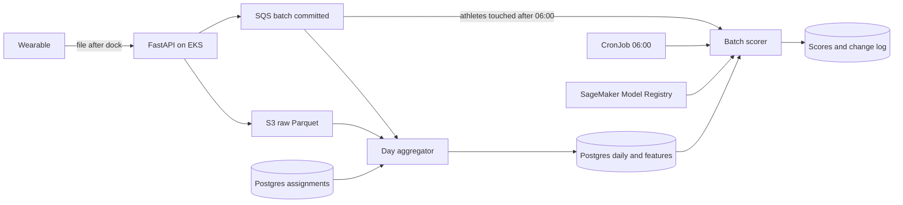

# Injury risk from wearable workload

Column-level tables, a worked example, the demo, and the data-prep queries live beside this file: [data-model.md](data-model.md), [sample-data.md](sample-data.md), [dashboard.html](dashboard.html), and [data-prep.sql](data-prep.sql).

## Assumptions and size

- Inertial data is the motion stream from the device's inertial sensor: linear acceleration (`ax`, `ay`, `az`) and rotation (`gx`, `gy`, `gz`), 100 times a second. It measures how the body changes speed and orientation. GPS is a separate 10 Hz stream of where the athlete is and how fast they are moving. Both are written on the device during the session and uploaded later as one file per device, often in several chunks.
- The sizing day is the stated peak: 1,000 athletes, each with one 90-minute session, overlapping. A second session (a match after training) doubles the day.
- One inertial row is about 48 bytes uncompressed: device timestamp, sequence, six float32 channels. Parquet with zstd stores it at about 20 bytes.
- Devices are identified by serial. Who wore one is a separate time range, and a device may change athletes in the middle of a session. Samples are attributed with the assignment that was valid at the sample's local time.
- "Injury" means a time-loss injury with onset in the next 7 days, entered by medical staff. The wearable does not infer the label.
- One organization timezone, stored as an IANA name such as `America/New_York`. 06:00 is that local time. Every timestamp that places a sample, session, assignment, or minute on a day is stored as that wall-clock time, with the timezone in its own column. The date is the date part of that value. An evening session that crosses UTC midnight stays on one local date. Server audit times (`received_at`, `scored_at`) stay UTC instants, because they do not decide which day a session belongs to.
- The model sees one row per athlete per morning, built from daily totals. It does not see 100 Hz samples.

Numbers for that peak day:

- Generated on the devices, while the session is happening: 1,000 × 100 Hz = **100,000 inertial rows/s**. The API never receives that rate. It receives on the order of 1,000 file-completion calls after the session.
- One 90-minute window: 1,000 × 100 × 5,400 s = **540 million inertial rows**, about **26 GB** uncompressed and about **11 GB** in Parquet. GPS adds 54 million rows and about **1 GB**.
- **About 12 GB/day** of raw data in S3 for one session each, about **25 GB/day** when a second session is added. A year of the busier figure is a few terabytes.
- Assignments, daily aggregates, rolling features, and scores are thousands of rows a day. They stay in Postgres and are negligible next to the raw files.

What lives where:

- Raw inertial and GPS files stay in S3, partitioned by the date part of the session's local start time (not the arrival date, and not a UTC date), then `device_id` and `batch_id`. A session that runs past local midnight stays under the start date, samples after midnight included. S3 Standard for 90 days, then Glacier. Files are immutable. A correction never rewrites them.
- The sync ledger, device-to-athlete ranges, minute totals, daily aggregates, rolling features, scores, and the coach's change log live in RDS Postgres.
- A day is rebuilt by re-reading that athlete's raw files for that date and applying the current assignment ranges. Rebuilding one athlete-day is a few tens of megabytes, so late data and mid-session swaps share one code path.
- Weekly training reads an immutable snapshot exported from Postgres to S3. Model binaries live in S3 and are registered in SageMaker Model Registry.

## Schema

Postgres. Business timestamps are `timestamp without time zone` plus a `tz` column (IANA name). Ranges for one device in one timezone cannot overlap, enforced with an exclusion constraint on `device_id`, `tz`, and `tsrange(valid_from, valid_to)`.

**teams** — `team_id` uuid PK, `name`, `tz`.

**athletes** — `athlete_id` uuid PK, `team_id` FK, `display_name`, `position`, `active`.

**devices** — `device_id` uuid PK, `serial` unique, `firmware`.

**device_assignments** — who wore the device. `assignment_id` uuid PK, `device_id` FK, `athlete_id` FK, `valid_from` local timestamp, `valid_to` local timestamp null while open, `tz`, `reason` (`pre_session`, `mid_session_swap`, `correction`), `created_at`. Half-open range `[valid_from, valid_to)`.

**sessions** — one continuous recording on a device. `session_id` uuid PK, supplied by the device. `device_id` FK, `started_at` and `ended_at` as local timestamps, `tz`, `expected_imu_rows` (the device's own count for the whole recording, known even when chunks upload later), `metric_date` (the date part of `started_at`, no conversion). Minutes after local midnight stay on this `metric_date`.

**sync_batches** — one uploaded chunk of a session. `batch_id` uuid PK, supplied by the gateway so retries are safe. `session_id` FK, `device_id` FK, `received_at` UTC, `local_ts_start`, `local_ts_end`, `tz`, `utc_offset_minutes` (the offset applied when converting the device clock, so the repeated hour on a fall clock change is unambiguous), `s3_uri`, `content_sha256`, `imu_rows`, `gps_rows`, `status` (`pending`, `landed`, `aggregated`, `failed`).

**minute_metrics** — rebuilt with the day, used for drill-down. PK `(athlete_id, minute_ts)`. `minute_ts` is the local minute, `tz`, `session_date` is the date part of `minute_ts`, `distance_m`, `high_speed_distance_m`, `sprint_count`, `accel_load`, `impact_count`, `max_speed_mps`, `duration_s`, `coverage`. `accel_load` is the sum of the Euclidean norm of successive accelerometer deltas, and the formula is tagged with `metric_version`.

**daily_aggregates** — the facts the features are built from. PK `(athlete_id, metric_date)`. `team_id`, `distance_m`, `high_speed_distance_m`, `sprint_count`, `accel_load`, `impact_count`, `max_speed_mps`, `duration_s`, `session_count`, `coverage`, `metric_version`, `updated_at`. `metric_date` is the session start date, so a session crossing midnight counts entirely on the day it started. `coverage` is the fraction of that day's sessions that has actually arrived: valid attributed inertial samples divided by `expected_imu_rows` for those sessions. A 90-minute recording with only the first 36 minutes uploaded has coverage 0.4. Observed load is not scaled up to fill the gap. A rest day has no row. `coverage_7d` is the average of this value over the session days in the 7-day window. Below 0.7 the morning score is `insufficient_data`, because a low load would otherwise mean "the file is not here yet."

**rolling_features** — one revision per compute. PK `(athlete_id, as_of_date, feature_set_version, revision)`. A row is written every morning for every active athlete. `as_of_date` is the day being predicted. Revision 1 is that morning's 06:00 vector. Later revisions correct the same day. Columns: `load_7d`, `load_28d`, `ewma_load_7d`, `ewma_load_28d`, `acwr_ewma` (`ewma_7d / ewma_28d`), `distance_7d`, `distance_28d`, `hsd_7d`, `hsd_28d`, `monotony_7d`, `strain_7d`, `days_since_session`, `coverage_7d`, `days_since_injury`, `prior_injury_90d`, `position`, `feature_hash`. The 7 and 28 dates are inputs only: the local dates before `as_of_date`. The day's own session has not happened yet, so it is not an input. It becomes an input the next morning.

**injuries** — `injury_id` uuid PK, `athlete_id` FK, `occurred_on` date, `time_loss` bool, `days_lost`, `recorded_at`.

**model_versions** — `model_version` text PK, `feature_set_version`, `label_def_version`, `artifact_s3_uri`, `image_digest`, `git_sha`, `training_snapshot_s3`, `seed`, `metrics` jsonb, `band_thresholds` jsonb, `stage` (`staging`, `production`, `archived`), `approved_at`.

**score_runs** — `score_run_id` uuid PK, `trigger` (`scheduled`, `late_data`, `assignment_correction`), `model_version` FK, `as_of_date`, `started_at`, `finished_at`.

**athlete_scores** — `score_id` uuid PK, `score_run_id` FK, `athlete_id`, `as_of_date`, `feature_revision`, `feature_hash`, `risk` null when coverage is too low, `band` (`insufficient_data`, `low`, `moderate`, `high`), `top_contributions` jsonb (three features), `is_current`, `scored_at`. One current row per `(athlete_id, as_of_date)`.

**score_changes** — what the coach reads after 06:00. `change_id` uuid PK, `athlete_id`, `as_of_date`, `prev_score_id`, `new_score_id`, `prev_risk`, `new_risk`, `reason_code`, `feature_deltas` jsonb (`name`, `old`, `new`), `batch_ids` uuid[], `summary` text, `created_at`.

Raw Parquet columns, both datasets, under `s3://.../imu/dt=YYYY-MM-DD/device_id=/batch_id=.parquet` and the same for `gps/`:

- Inertial: `local_ts`, `tz`, `seq`, `ax`, `ay`, `az`, `gx`, `gy`, `gz`.
- GPS: `local_ts`, `tz`, `lat`, `lon`, `speed_mps`, `hdop`.

`dt` is a plain string, the session's local start date, the same value as `metric_date`. S3 does not interpret it as UTC. `tz` is inside the file, the same value on every row, so dictionary encoding keeps it small. A session from 19:00 to 23:30 local is one prefix even when those clock times fall on two UTC dates. A rebuild of that local day lists one prefix.

Athlete id is not written into the raw file. A batch is not split at midnight. Every chunk of a session is stored under that session's start date, so a rebuild of the session reads one prefix and the workload stays on one `metric_date`.

Unassigned samples are not dropped. The aggregator writes an **unassigned_spans** row (`device_id`, `local_ts_start`, `local_ts_end`, `tz`, `batch_id`) and leaves those samples out of every athlete total until someone adds an assignment.

## Ingestion

1. The file bytes go straight from the dock to S3. FastAPI never receives the file. The dock calls `POST /sync-batches` with `batch_id`, `device_id`, and the device time span. FastAPI inserts `sync_batches` as `pending` and returns a presigned URL. The dock PUTs the file to that URL. It then calls `POST /sync-batches/{batch_id}/complete` with `content_sha256` and the clock offset. FastAPI checks the object is in S3, marks the row `landed`, and publishes one SQS message. A repeated `batch_id` returns the original row and does not publish a second message.
2. An EKS worker reads the message, converts the device clock to team local time once, and writes `local_ts` with `tz`. It finds the assignment covering that local time. It rebuilds the session's `metric_date` (the date part of the local start, including any minutes after local midnight): read that prefix, apply current assignments, replace `minute_metrics` and `daily_aggregates` for the athletes who wore the device in that session. Coverage is recomputed from samples arrived so far divided by `expected_imu_rows`.
3. If today's 06:00 score already exists and a rebuilt day falls inside today's 28-day window, the worker marks those athletes for a partial rescore. A session usually arrives as several chunks a few minutes apart. The rescore waits about five minutes and folds every chunk for that athlete into one new score and one change-log row, so the coach sees one correction for the session.
4. An assignment edit uses the same rebuild. The `reason_code` on the change row is `assignment_correction` instead of `late_data`.

FastAPI also serves `POST /assignments`, `POST /injuries`, `GET /athletes/{id}/risk?date=`, and `GET /athletes/{id}/risk/changes?date=`.

## Training

Score with a **LightGBM classifier** on the rolling-feature row. The output is the probability of a time-loss injury in the next 7 days. The same weekly job trains a penalized logistic regression on the same matrix and keeps it as the comparison baseline. Promote the tree only when it is better on the time-based holdout by PR-AUC and Brier score, and the probabilities are calibrated (isotonic, fit on the holdout only).

This stays a small tabular model because a morning has about a thousand rows and injuries are rare. The 100 Hz signal is reduced to load, distance, sprints, and impacts before any learning.

Cadence is weekly, on Sunday, started by EventBridge, run as a SageMaker training job from a pinned ECR image.

- The dataset is one row per athlete per morning, and only mornings whose 7-day outcome is already finished. For Monday 10 March the outcome days are 10 March through 16 March. That morning is closed on 17 March. The Sunday job on 16 March includes mornings through 9 March, so 10 March is not in it. The first Sunday job that includes 10 March is 23 March.
- The model that scored 10 March was trained on Sunday 9 March. Its newest labeled morning is 2 March. Inputs for that morning are 23 February through 1 March. The holdout is the eight weeks from 6 January through 2 March. Mornings through 5 January are what the model learns from.
- The inputs are revision 1, the feature values from that morning's 06:00 score. On Monday 10 March at 06:00, Sunday's session is only half uploaded and `load_7d` is 2,950. At 14:12 the rest arrives and revision 2 has `load_7d` 3,150. The 23 March job uses 2,950. Those were the numbers available when the score was made. Using 3,150 would teach the model with data the 06:00 job did not have.
- The label is 1 when `injuries` has a time-loss row with `occurred_on` on any of those 7 days. An injury on 12 March makes Monday 10 March a 1. An injury on 18 March leaves it a 0. A morning with no time-loss injury in its 7 days is a 0.
- The split is walk-forward by date. The last 8 closed weeks are the holdout. Rows are never split at random.
- Mornings with `coverage_7d` below 0.7 are excluded from training, matching production, which will refuse to show a risk band for those mornings.

Lifecycle of a package: the job writes `model.tar.gz` (booster, feature list, `feature_set_version`, thresholds, metrics) to S3 and registers it in SageMaker Model Registry at `staging`. A person approves it to `production`. The scorer loads only the package whose stage is `production`, and it refuses to run if `feature_set_version` differs from the feature code. Rollback is moving the production stage back to the previous package. Old mornings keep the version they were scored with.

Reproducibility is the training job's own record plus a copy on `model_versions`: git SHA, image digest, seed, hyperparameters, `feature_set_version`, `label_def_version` (time-loss, horizon 7 days), and the S3 snapshot URI of the feature and injury export, identified by a manifest hash. A later run with the same snapshot and seed produces the same booster.

## Scoring

**Every day at 06:00.** A Kubernetes CronJob predicts that calendar day for every active athlete. Monday's run predicts Monday. Tuesday's run predicts Tuesday, and its 7-day and 28-day inputs have each moved forward one day. The day's session is not an input at 06:00.

1. Take active athletes.
2. Build revision 1 of `rolling_features` for today from `daily_aggregates`. Days with no sessions contribute zeros and lower `coverage_7d`.
3. If `coverage_7d` is under 0.7, write `band = insufficient_data` and a null risk. Otherwise score the batch with the production booster, apply that version's band thresholds, and store the three largest feature contributions.
4. Insert `athlete_scores` as current. This first run has no change-log row.

**After 06:00.** The aggregator enqueues the athletes whose rebuilt days intersect the 28 days before today. The rescore worker waits about five minutes so the chunks of one dock become one correction:

1. Recomputes rolling features as the next revision for those athletes only.
2. Scores the same way, with the same production model.
3. If `feature_hash` and band are unchanged, it stops, so a retried message does not produce a second correction.
4. Otherwise it clears `is_current` on the previous row, inserts the new score, and inserts `score_changes` with the feature deltas, the `batch_ids`, and a one-line summary built from the deltas. Example shape: yesterday's session arrived at 14:12, high-speed distance for that day went from 0 to 1.8 km, 7-day load went from 4,200 to 5,100, risk went from 0.18 to 0.31.
5. Data older than 28 days updates `daily_aggregates` and leaves today's score alone. Earlier mornings are left as the record of what was believed then. An explicit backfill can rescore them; the daily job does not.

The coach's screen reads the current score for the date and the `score_changes` rows since revision 1, so each correction shows the old number, the new number, and the workload days that moved.
